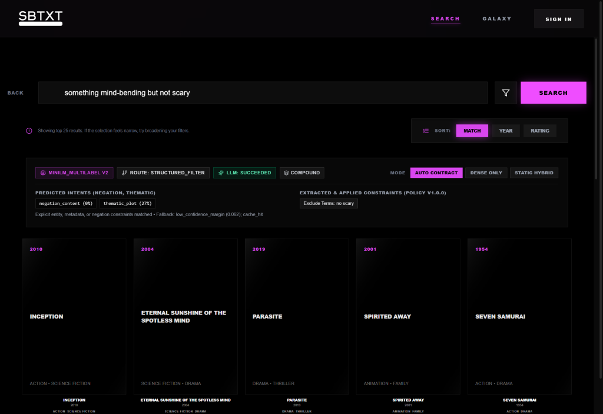

# Deliverable 2 Part A — Serving, UI Diagnostics & Cloud Deployment Evidence

## 1. Live Course Deployment Endpoints (Isolated from Live Subtext)

| Component | Deployed Resource / Endpoint | Notes |
|---|---|---|
| **Backend API (HTTPS)** | `https://54-210-225-89.sslip.io` | AWS EC2 `t3.micro` (`i-023715b71b1ddb01a`, `us-east-1`, 2 GB swap) behind Caddy 2 TLS reverse proxy + isolated `postgres:16-alpine` demo DB |
| **Course Frontend (HTTPS)** | `https://subtext-mlops-course.vercel.app/search` | Separate Vercel project `subtext-mlops-course` (`prj_XAozBh4qIWnD3LDpKCYuQD9VhL7b`), `NEXT_PUBLIC_API_URL=https://54-210-225-89.sslip.io`, CSP isolated from production origins |
| **Digest-Pinned ECR Image** | `904966651145.dkr.ecr.us-east-1.amazonaws.com/subtext-mlops-serve@sha256:19753266eba1199622f5e37a86c068c88a1aa9de2b6d05a99198c22ce246a4e5` | Tag `:d2-v1`, image size `2.62GB`, built from `Dockerfile.serve` |
| **Pinned D1 Model Release** | `subtext-intent-multilabel` v2 (`minilm_multilabel`) | Bundle fingerprint `4fb663cb67dcc1f0`, loaded once at startup from DVC-managed `artifacts/primary` (fails closed HTTP `503` if missing) |
| **Course S3 Artifact Bucket** | `subtext-mlops-course-904966651145` (`us-east-1`) | Public access blocked, tagged `Project=subtext-mlops-course` |
| **Budget Cap** | `subtext-mlops-course-cap` | AWS Budgets `$10/month` cap |

---

## 2. Live HTTPS Endpoint Outputs

### `/health`, `/ready`, and `/version`
- `GET https://54-210-225-89.sslip.io/health` → `200`:
  ```json
  {"status": "ok"}
  ```
- `GET https://54-210-225-89.sslip.io/ready` → `200`:
  ```json
  {
    "status": "ready",
    "model_name": "subtext-intent-multilabel",
    "model_id": "minilm_multilabel",
    "model_version": "2",
    "bundle_fingerprint": "4fb663cb67dcc1f0",
    "taxonomy_version": "1.0.0",
    "route_policy_version": "1.0.0",
    "prompt_version": "1.0.0",
    "schema_version": "1.0.0",
    "image_digest": "904966651145.dkr.ecr.us-east-1.amazonaws.com/subtext-mlops-serve@sha256:19753266eba1199622f5e37a86c068c88a1aa9de2b6d05a99198c22ce246a4e5",
    "model_loaded": true
  }
  ```

### `/predict` — High-Confidence Small Model Path (`llm_fallback.called = false`)
Query: `"Korean crime thriller starring Song Kang-ho with no gore"`
```json
{
  "predicted_fine_labels": ["person_actor", "attribute_genre", "attribute_language_country", "negation_content"],
  "predicted_broad_labels": ["attribute", "negation", "person"],
  "is_compound": true,
  "extraction": {
    "actors": ["Song Kang-ho"],
    "directors": [],
    "genres": ["Crime", "Thriller"],
    "year_min": null,
    "year_max": null,
    "language": "ko",
    "excluded_genres": [],
    "excluded_terms": ["gore"],
    "reference_titles": []
  },
  "selected_route": "structured_filter",
  "route_reason": "Explicit entity, metadata, or negation constraints matched",
  "llm_fallback": {
    "called": false,
    "status": "not_called",
    "reason": "high_confidence_small_model"
  }
}
```

### `/predict` — Selective Live LLM Fallback (`qwen/qwen3.8-27b`)
Query: `"something mind-bending but not scary"`
```json
{
  "predicted_fine_labels": ["negation_content", "thematic_plot"],
  "predicted_broad_labels": ["negation", "thematic"],
  "is_compound": true,
  "extraction": {
    "actors": [],
    "directors": [],
    "genres": [],
    "year_min": null,
    "year_max": null,
    "language": null,
    "excluded_genres": [],
    "excluded_terms": ["scary"],
    "reference_titles": []
  },
  "selected_route": "structured_filter",
  "route_reason": "Explicit entity, metadata, or negation constraints matched",
  "llm_fallback": {
    "called": true,
    "status": "succeeded",
    "reason": "low_confidence_margin (0.062)"
  }
}
```

---

## 3. UI & Browser End-to-End Verification

- Opened `https://subtext-mlops-course.vercel.app/search` in headless Chromium (`200`, `0` failed HTTP requests).
- Verified both queries live through `/api/search` → `https://54-210-225-89.sslip.io`:
  - `"Korean crime thriller starring Song Kang-ho with no gore"` rendered `MINILM_MULTILABEL V2`, `ROUTE: STRUCTURED_FILTER`, `LLM: NOT_CALLED`, intents (`person_actor 100%`, `attribute_genre 99%`, `attribute_language_country 100%`, `negation_content 100%`), constraints (`Genres: Crime, Thriller`, `Exclude Terms: no gore`, `Actors: Song Kang-ho`, `Language: KO`), and cards `Memories of Murder (2003)` and `Parasite (2019)`.
  - `"something mind-bending but not scary"` rendered `LLM: SUCCEEDED`, `Exclude Terms: no scary`, and 25 catalog cards (`Inception`, `Eternal Sunshine of the Spotless Mind`, `Parasite`, `Spirited Away`, `Seven Samurai`, etc.).
- Updated `frontend/next.config.mjs` CSP `connect-src` to read `NEXT_PUBLIC_API_URL` (`https://54-210-225-89.sslip.io`) with legacy production origins removed.
- Browser screenshot captured at [`screenshots/live_ui_diagnostics.png`](screenshots/live_ui_diagnostics.png).



---

## 4. Test & Lint Verification Summary

- `ruff check backend/ tests/ ml/`: `All checks passed!`
- `pytest backend/tests tests/test_d2_serving.py -v`: `58 passed` (includes `/health`, `/ready`, `/version`, `/predict` schema validation, `422` empty/oversized input bounds, `503` missing-artifact fail-closed behavior, offline versioned snapshot cache hit, simulated `httpx` timeout / invalid JSON / unknown-label safe fallbacks, unsupported constraint notices, and `auto` / `dense_only` / `static_hybrid` retrieval modes).
- `npm run build` (`Next.js 15.5.28`): built all 14 routes with 0 errors.
- Operations, digest-pinned rollback, and full resource teardown are documented in [`deploy/RUNBOOK.md`](../../deploy/RUNBOOK.md).
